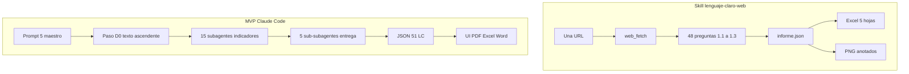

# Skill maestro: `lenguaje-claro-web` frente a la orquestación del MVP

Documento de comparación (rama `feat/comparar-skill-maestro-lc`). No cambia el motor de score ni los prompts; describe equivalencias, huecos y cómo complementar **sin sacar aún el flujo del PC local**.

**Fuentes**

| Lado | Qué es |
| --- | --- |
| Skill del jefe | Paquete Claude `docs/lenguaje-claro-web.skill` (ZIP). Extraído en `docs/lenguaje-claro-web/`. |
| MVP INAPI | Repo `lc-inapi.app`: `.claude/CLAUDE.md`, prompts 01–07, skills 01–06, 51 `LC-*` en `data/checklist-criteria-lc-ptd.json`, JSON de auditoría, UI/PDF/Excel/Word. |

Fecha de esta lectura: 2026-11-19. `origin/main` de referencia: `ab9294be`.

---

## 1. Cómo se abre el `.skill` y qué hay dentro

El archivo **no es Markdown**. Claude empaqueta una skill como **ZIP** con extensión `.skill`. En este PC el editor lo marca como binario; no hace falta pegar cada archivo a mano.

```powershell
python -c "import zipfile; zipfile.ZipFile(r'docs/lenguaje-claro-web.skill').extractall(r'docs')"
```

Inventario extraído (`docs/lenguaje-claro-web/`):

| Ruta | Rol |
| --- | --- |
| `SKILL.md` | Frontmatter (`name`, `description`) + flujo: una URL, Sí/No/No aplica/No verificable, Excel siempre, capturas anotadas. |
| `references/criterios.md` | Preguntas literales IEW 1.1.x–1.3.x, ejemplos y cuándo vale «No aplica». |
| `assets/criterios.json` | Misma pauta en JSON (código, nivel, preguntas, `noAplica`). |
| `assets/ejemplo_informe.json` | Informe de portada INAPI (respuestas + `cambios` + limitaciones). Nombre real: `ejemplo_informe.json` (no `ejemplos_informe.json`). |
| `assets/ejemplo_respuestas.json` | Entrada mínima para `score.py`. |
| `assets/ejemplo_anotaciones.json` | Cajas en píxeles para `anotar_capturas.py` (rutas `/mnt/user-data/…` = cloude.ai). |
| `scripts/score.py` | Puntaje 0–3 por indicador y % por nivel / global. |
| `scripts/generar_planilla.py` | Excel: Resumen, Cambios, Detalle, Preguntas, Notas + LibreOffice. |
| `scripts/anotar_capturas.py` | Recuadros rojo / amarillo / verde / gris (Pillow). |

Diseño de la skill: **Claude (web o app) + `web_fetch` + Excel + PNG**, una URL, sin Playwright, sin repo, sin 51 `LC-*`.

---

## 2. Dos orquestaciones (visión)



| Dimensión | Skill | MVP |
| --- | --- | --- |
| Unidad de evaluación | Una URL; **prohibido** abrir destinos | Una URL = un JSON; en hubs **sí** abrir destino de 1 clic (C-2026-11-04a) |
| Captura | Usuario pega PNG; si no, «No verificable» | Playwright MCP + HTML + a11y; evidencias `S0N` |
| Criterios | 15 indicadores IEW, **48 preguntas** | **51** `LC-*` (48 IEW + 3 IESD: `LC-5.2.1-01`, `LC-5.2.2-01`, `LC-5.2.4-01`) |
| Respuesta | Sí / No / No aplica / **No verificable** | `cumple` / `incumple` / `no_aplica` (sin «no verificable») |
| Score | 0–3 por indicador (umbrales 100 % / 60 % / >0); % nivel = suma/3N; % global = Sí / aplicables | Un estado por `LC-*`; % = cumple / (cumple+incumple); umbral URL ≤80 / 81–90,9 / ≥91 |
| Prioridad | Alta/Media/Baja según nivel IEW + puntaje 0–3 | `severidad` alta/media/baja **solo** si `incumple`; etiqueta MEI distinta |
| Entrega | Excel obligatorio; chat = resumen corto | JSON canónico → UI, PDF, Excel MEI, Word 6 cols (respaldo) o 5 cols (proveedor) |
| Agrupación | Un cambio, no repetir; header/footer «Todas las páginas» | `patron_sistema`; §20.3 / C-2026-11-09a; Word proveedor consolida header/footer |
| Calibración INAPI | Casi nada (ejemplo INAPI en JSON) | Prompt 6 hasta C-2026-11-17b; gate §22.12 |
| Stack | Python + openpyxl + Pillow + LibreOffice | bun/TS, Zod, Next, Playwright, RAG opcional |

---

## 3. Tabla de equivalencias (criterio ↔ `LC-*`)

La numeración **1.1.1 … 1.3.3** es la misma familia IEW. En el MVP cada **pregunta** es un `LC-*`; en la skill cada **indicador** agrupa N Sí/No y sale un 0–3.

| Indicador skill | Preguntas | `LC-*` MVP | Nota |
| --- | --- | --- | --- |
| 1.1.1 Fiabilidad | 1 | `LC-1.1.1-01` | Alineado. |
| 1.1.2 Completitud | 4 | `LC-1.1.2-01` … `-04` | P3 datos clave = calibración 04b/17a (inserción, no aplastar H1). P4 trámites = `LC-1.1.2-04`; en MVP **no** usar «no es trámite» para el 12 (`LC-1.1.2-03`). |
| 1.1.3 Lenguaje plano | 6 | `LC-1.1.3-01` … `-06` | Conceptos oficiales: skill pide no-jerga; MVP **conserva** Observancia/PCT + glosa hover (04c/17a). |
| 1.1.4 Actualización | 1 | `LC-1.1.4-01` | Skill: fecha o vigencia. MVP: «Actualizado» **solo en el pie** junto al © (04d/05c); © solo **no** cuenta. |
| 1.1.5 Ortografía | 3 | `LC-1.1.5-01` … `-03` | Skill: >1 error → No al indicador. MVP: cada pregunta aparte; más de un texto = N filas `sustituciones`. |
| 1.1.6 PI | 2 | `LC-1.1.6-01` … `-02` | Skill: enlace basta, no abrir. MVP igual en espíritu; búsqueda inversa → skill «No verificable». |
| 1.1.7 Privacidad | 3 | `LC-1.1.7-01` … `-03` | MVP: RUT institucional = cumple; sesión autenticada §19. |
| 1.1.8 Sensibles | 3 | `LC-1.1.8-01` … `-03` | Alineado si no hay menores/violencia en la URL. |
| 1.2.1 Claridad | **5** | `LC-1.2.1-01`…`-05` **+ `LC-5.2.1-01`** | Skill **no** tiene la pregunta IESD de FAQ del servicio. |
| 1.2.2 Concisión | **5** | `LC-1.2.2-01`…`-05` **+ `LC-5.2.2-01`** | Skill **no** tiene la fila IESD extra de concisión. |
| 1.2.3 Legibilidad | 3 | `LC-1.2.3-01` … `-03` | Skill marca alineación «No verificable» sin captura. |
| 1.2.4 Escritura web | **8** | `LC-1.2.4-01`…`-08` **+ `LC-5.2.4-01`** | CTA/rótulos (`LC-5.2.4-01`) es la 9.ª fila MVP; skill la mezcla en 1.2.4 o no la evalúa como IESD. LINK EXTERNO: MVP **eliminar** (04e). |
| 1.3.1 Visualización | 1 | `LC-1.3.1-01` | MVP: no usar este id para `alt`/WCAG (§23). |
| 1.3.2 Objetividad | 2 | `LC-1.3.2-01` … `-02` | Skill umbral ~80 % de adjetivos: aproximado. |
| 1.3.3 Archivo | 1 | `LC-1.3.3-01` | Skill: sin archivo → **No aplica**. No marcar No por ausencia. |

**Score**

| Skill `score.py` | MVP |
| --- | --- |
| `pct = 100 * Sí / (Sí+No)`; 100→3, ≥60→2, ≥0,01→1, 0→0 | No hay 0–3. `incumple` + `severidad`. |
| % nivel = suma puntajes / (3 × indicadores) | % URL ≈ criterios `cumple` / aplicables (no_aplica fuera del denominador, según consolidación JSON). |
| % global = Sí / preguntas aplicables **si hay 3 niveles** | Un % por URL; `estado_aceptacion` por umbral 80 / 91. |
| «No verificable» **fuera** del cálculo | No existe; o se captura Playwright, o `incumple`/`no_aplica` con comentario. |

**Prioridad / severidad** (no son el mismo eje)

| Skill (script planilla) | MVP (presentación) |
| --- | --- |
| Alta: imprescindible con puntaje ≤1 | `incumple` + `alta` → No cumple |
| Media: imprescindible con 2 **y todos los esperables** | `incumple` + `media` → Medianamente cumple |
| Baja: deseables y fuera de pauta | `incumple` + `baja` → Cumple con observaciones |

Un «esperable» en la skill es **siempre Media**. En el MVP un esperable puede ser alta (p. ej. ausencia total de fecha ya está en imprescindibles; CTA genérico puede ser alta). No mapear 1:1 sin regla.

**Planilla ↔ entrega MVP**

| Hoja skill | Superficie MVP |
| --- | --- |
| Resumen (% por nivel) | Resumen JSON + hitos `resumen-hitos-auditoria.ts` + Excel MEI |
| Cambios (ubicación, problema, cambio, verificar) | `sustituciones[]` + Word (original / propuesto / observaciones) |
| Detalle (puntaje 0–3) | Tabla 51 criterios UI/PDF |
| Preguntas | `criterios_evaluados[].comentario` |
| Notas (umbrales editables) | Fijos en CLAUDE.md §5; no hay hoja Notas |

Colores de captura skill (rojo 1.1 / amarillo 1.2 / verde 1.3) ≠ colores Word proveedor (amarillo = **texto nuevo**). Las evidencias MVP son rectángulo + flecha `S0N` por solicitud, no por nivel IEW.

---

## 4. Qué le falta al MVP respecto de la skill

1. **Informe Excel de «pauta clásica»** (5 hojas, fórmulas, umbrales en Notas, % por nivel imprescindibles/esperables/deseables). El Excel MEI habla Hito–Tarea–Criterio PTD, no 0–3.
2. **Puntaje 0–3 por indicador** y % global tipo planilla (Sí/aplicables). Hoy el % aplana 51 preguntas.
3. **Estado «No verificable»** para lo que `web_fetch` no ve (alineación, búsqueda inversa de imágenes, captura incompleta).
4. **Anotación por nivel de criticidad** (rojo/amarillo/verde + leyenda numerada) vía `anotar_capturas.py`. El pipeline actual anota **solicitudes** para TI, no la pauta IEW.
5. **Ejemplos de informe/respuestas/anotaciones** empaquetados para un auditor que no conoce el repo (`assets/ejemplo_*.json`). El MVP tiene fixtures de auditoría y DEVLOG, no ese contrato JSON de 48 Sí/No.
6. **Mensaje de chat corto + archivo**: la skill prohíbe pegar tablas en el chat. El MVP muestra todo en `/auditar/resultado`.
7. **Evaluación parcial por nivel** (solo imprescindibles) que la skill permite. El MVP exige cobertura 51.
8. **Independencia de máquina**: la skill corre en Claude.ai con `/mnt/user-data`. El MVP asume bun, Playwright, paths de Windows/WSL.

Útil para **complementar auditorías ya hechas**: reproyectar un JSON de 51 `LC-*` a 15 indicadores 0–3 y a la planilla, para contrastar con lo que el jefe obtiene solo con Claude.

---

## 5. Qué le falta a la skill respecto del MVP

1. **3 criterios IESD** (`LC-5.2.1-01`, `LC-5.2.2-01`, `LC-5.2.4-01`) y la regla de evaluar CTA en **todas** las URLs (C-2026-08-25c).
2. **Calibraciones INAPI** C-2026-11-04a–f, 05a–c, 09a/b, 10a/b, **17a/b**: origen↔destino, fecha solo en pie, no reescribir misión/visión/objetivos, no renombrar menú (hover), no fusionar H1+pestañas, presupuesto 15 h, Word 5 columnas, avisos con hechos.
3. **Contradicción de alcance:** la skill **prohíbe** abrir «Para informarse», noticias, privacidad. El MVP **exige** abrir destinos de 1 clic en hubs y no citar el destino como Texto de esta URL. Sin esto, Completitud/datos clave de Portada/Marcas queda corta.
4. **Playwright / DOM / sesión** (trámites, ClaveÚnica §19). `web_fetch` no ve CSS de mayúsculas ni modales.
5. **Estados `cumple`/`incumple`/`severidad`** y umbral de **aceptación de URL** (rechazado / aceptado con observaciones / aprobado).
6. **Entrega CMS:** 4 campos ciudadanos, `ubicacion_pantalla`, propuesto pegable, **prohibido** `LC-*` en Observaciones del Word proveedor, original vacío si inserción.
7. **Arquitectura §17:** D0 texto ascendente, 15 subagentes, 5 sub-subagentes, gate §22.12 (37–42).
8. **Agrupación de sitio y avisos TIC:** `patron_sistema`, 130 avisos, HTML propuesto.
9. **Ids de criterio máquina** `LC-*` y mapa PTD Hito→Tarea (`ptdHitoTareaPorCriterio`). La skill solo habla 1.1.5.
10. **RAG / Prompt 6 vivo** y consistencia entre URLs de la muestra META MEI.
11. **Rutas y recálculo:** `/mnt/user-data`, LibreOffice, skill `xlsx` de Claude.ai — no portables a Windows empresa sin adaptar.
12. **Hero / noticias:** la skill puede **inventar** copy en `cambio`; el MVP lo prohíbe (Casos 2 y 8) y pide encargo a Comunicaciones.

El `ejemplo_informe.json` de portada INAPI ya choca en parte con 17a (p. ej. pie en mayúsculas vs hover; «industrial» vs veto de nombre institucional). Hay que revalidar ese ejemplo contra Prompt 6.

---

## 6. Cómo complementar (sin salir aún del PC local)

Fuente de verdad **jurídica/PTD/INAPI** = este repo (`.claude/` + `checklist-criteria-lc-ptd.json`). La skill es **proyección de pauta IEW + Excel clásico**, útil para el jefe en Claude.ai y para contrastar huecos.

### Qué copiar a la skill (siguiente iteración del `.skill`)

- En `SKILL.md`, un bloque **INAPI / META MEI** (corto): no abrir destinos **salvo** hubs (1 clic, contexto, no mezclar Texto); fecha en pie; no reescribir misión/visión; menú = hover; no H1+pestañas; CTA header no se renombra; LINK EXTERNO se elimina; no inventar hero/noticias; `[N]` y plazos inventados prohibidos.
- En `assets/criterios.json` / `references/criterios.md`: tres preguntas IESD o un anexo `criterios-iesd.json` alineado a `LC-5.2.*`.
- Sustituir «No verificable» **cuando hay captura** por Sí/No (como el MVP).
- Rutas de scripts: además de `/mnt/user-data`, aceptar paths relativos (Windows/WSL).
- Reescribir `ejemplo_informe.json` con C-2026-11-17a/b.

### Qué no duplicar en la skill

- Los 51 `LC-*`, Zod, launch, Word 5/6 columnas, avisos 130, RAG, Playwright.
- Prompt 6 completo (crece cada semana). La skill solo lleva un **resumen de gates**.

### Qué queda en `.claude/` como dueño

- Prompt 5 + CLAUDE.md §17/§22.
- Calibraciones C-YYYY.
- JSON canónico y umbrales de aceptación.
- Word proveedor vs respaldo.

### Puente mecánico (recomendado, aún no implementado)

Un script en el MVP, p. ej. `src/scripts/export-pauta-iew.ts`:

1. Lee un JSON de auditoría 51 `LC-*`.
2. Agrupa por `indicator_code_iew` (15 indicadores).
3. Mapea `cumple`→Sí, `incumple`→No, `no_aplica`→No aplica.
4. Emite `informe.json` compatible con `generar_planilla.py` / `score.py`.
5. Opcional: mapear `evidencia_visual` a cajas para `anotar_capturas.py` (coordenadas distintas: Playwright vs píxeles de PNG de usuario).

Así se **complementan auditorías recientes** (lo que pidió el jefe): la skill no reaudita a ciegas; se ve qué preguntas IEW el MVP ya cubrió y cuáles la skill marcaría No verificable.

Dirección inversa (skill → MVP): un `informe.json` **no** genera 51 filas ni `sustituciones[]` CMS. Haría falta un mapeo pregunta→`LC-*` y reescritura de propuesto (skill 02). No automatizar eso hasta fijar el puente 51→IEW.

---

## 7. Conflictos a resolver antes de «robustecer» código

1. **¿Se abren destinos?** Skill: no. MVP: sí en hubs. Propuesta: skill INAPI = regla MVP; skill genérica = una URL.
2. **48 vs 51 preguntas.** Sin las 3 IESD, el % skill y el % MVP no son comparables.
3. **No verificable vs incumple.** En META MEI, sin captura Playwright no debería publicarse un % «oficial».
4. **Prioridad skill vs severidad MVP.** No usar Alta skill como `severidad: alta` sin tabla explícita.
5. **Dos Word de proveedor** (`docs/proveedor-solicitudes-texto.docx` vs `docs/words-solicitudes-correccion/…`) vs Excel skill: tres entregas distintas; no fusionar columnas.

---

## 8. Siguientes pasos (prioridad)

1. Adaptar `SKILL.md` + ejemplos INAPI a C-2026-11-17a/b y a las 3 IESD (reempaquetar `.skill`).
2. Script puente `51 LC → informe.json` + prueba con Portada y con avisos (avisos **no** caben en la pauta de una URL; excluirlos o rama aparte).
3. En el MVP, hoja o export «pauta IEW» (0–3 y % por nivel) **además** del Excel MEI, sin sustituirlo.
4. Unificar anotación: o bien colores IEW sobre la captura de Playwright, o bien documentar que `S0N` es solo TI.
5. Portar scripts Python a paths locales (sin `/mnt/user-data`) para el PC empresa.
6. Solo después: decidir si Claude.ai (skill sola) y Claude Code (repo) conviven, o si la skill se vuelve un **perfil de exportación** del MVP y el trabajo pesado se queda en este PC.

---

## 9. Conclusión

Las dos orquestaciones miden la **misma pauta de contenido y lenguaje claro**, pero:

- la skill es **planilla IEW de 15 indicadores / 48 preguntas**, una URL, Excel y marcas de color;
- el MVP es **51 LC PTD**, evidencia de DOM, calibración INAPI y entrega CMS/proveedor.

No se pisan si se trata la skill como **vista IEW + Excel clásico** y el MVP como **sistema de registro y de implementación**. El cruce peligroso es evaluar Portada INAPI con la skill **sin** 04a/17a: el informe saldrá más pobre y a veces contrario (renombrar menú, no leer destinos, inventar copy).

Este archivo es el mapa para robustecer ambos; la implementación de scripts y el reempaquetado del `.skill` quedan para un turno siguiente.
